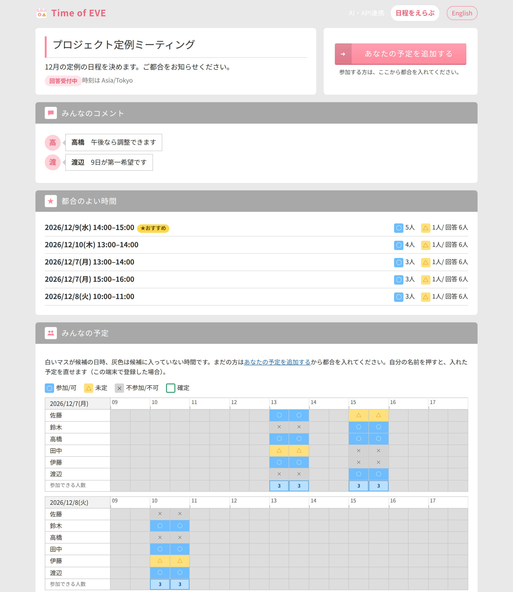

# Time of EVE

人間にもAIにも使いやすい日程調整ツール。○△× で都合を集め、重なる時間がひと目で分かります。参加者は登録不要。AIエージェントは REST API と MCP で、作成・回答・集計・確定まで完結できます。

**https://time-of-eve.com/** で稼働しています。

Cloudflare Workers + D1 で動作します（TypeScript / Hono / Drizzle ORM / Zod）。



## 主な機能

- 日程調整の作成（カレンダーとタイムラインで選ぶ／AIが作ったJSONを貼り付け）、回答、集計、確定、CSV出力
- 作成モードを管理者が切り替え: **管理者のみ** / **誰でも（ログイン不要）**。ログインなしで作成した人には**管理用URL**（主催者の鍵）を発行
- 管理者ダッシュボード: 全日程調整の一覧・検索・非公開化・削除、サイト設定、管理者アカウント、APIトークン
- ログインなしで作成された日程調整の自動削除（保持期間は設定で変更。Cron Trigger で毎日実行）
- AI向け: `llms.txt`、OpenAPI 3.1、JSON Schema、回答ページの Markdown / JSON 版、MCP サーバー（`/mcp`、管理者向けOAuth は `/mcp/admin`）
- OGP / Twitter Card の画像を動的生成（satori + resvg、WebAssembly）
- 日本語 / English

## AIからの使い方（要点）

| 入口 | 用途 |
|---|---|
| `/mcp` | MCP（Streamable HTTP）。参加者はトークン不要。「誰でも」モードなら作成もトークン不要（作成時に返る `manage_url` を以後のツールに渡す）。管理者は `Authorization: Bearer sch_…` |
| `/mcp/admin` | 管理者用 MCP。OAuth 2.1（claude.ai / ChatGPT のカスタムコネクタなど） |
| `/api/v1` | REST API。主催者は `X-Manage-Token`（管理用URLの末尾）または管理者トークン |
| `/llms.txt` | AI向け説明書（サイト設定に応じて内容が変わる） |

AIが間違えにくいよう、サーバー側で次のことを引き受けます。

- オフセットなしの現地時刻（`"2026-12-01T13:00"`）と `timezone` を受け付け、夏時間を含めてオフセットを決める
- `candidate_ranges`（「平日 13:00〜17:00」のような時間帯）を `duration_minutes` で候補に分割する
- `dry_run`、`client_request_id` による安全な再送、`{code, field, message, hint}` 形式のエラー

詳細は起動後の `/llms.txt` または [src/docs/llms.md](src/docs/llms.md) を参照してください。

### MCPクライアントへの登録例

URL は公開中の `https://time-of-eve.com` の例です。自分でデプロイした場合はそのドメインに読み替えてください。用途に応じて次のどちらかを登録します。

- **参加者・「誰でも」モードでの作成**: `/mcp` をトークンなしで登録します。
- **管理者**: `/mcp` に APIトークン（管理画面で発行する `sch_…`）を付けて登録するか、`/mcp/admin` を OAuth で登録します。画面のないマシンでは、ブラウザを使わない APIトークン方式が確実です。

**Claude Code**

```sh
# 参加者・「誰でも」モード
claude mcp add --transport http time-of-eve https://time-of-eve.com/mcp

# 管理者（APIトークン）
claude mcp add --transport http time-of-eve-admin https://time-of-eve.com/mcp \
  --header "Authorization: Bearer $TIME_OF_EVE_TOKEN"

# 管理者（OAuth）: 登録後、Claude Code で /mcp を開いて認証
claude mcp add --transport http time-of-eve-admin https://time-of-eve.com/mcp/admin
```

**claude.ai / Claude Desktop**

設定 → コネクタ → カスタムコネクタを追加 で、URL に `https://time-of-eve.com/mcp/admin` を入力します。接続時に同意画面が開くので、管理者でログインして許可します（参加者として使うだけなら `https://time-of-eve.com/mcp` でも構いません）。

**Codex CLI**

```sh
# 参加者・「誰でも」モード
codex mcp add time-of-eve --url https://time-of-eve.com/mcp

# 管理者（APIトークン）: トークンは環境変数から読ませる
export TIME_OF_EVE_TOKEN=sch_xxxxxxxx
codex mcp add time-of-eve-admin --url https://time-of-eve.com/mcp --bearer-token-env-var TIME_OF_EVE_TOKEN

# 管理者（OAuth）
codex mcp add time-of-eve-admin --url https://time-of-eve.com/mcp/admin
codex mcp login time-of-eve-admin
```

`~/.codex/config.toml` に直接書く場合:

```toml
[mcp_servers.time-of-eve]
url = "https://time-of-eve.com/mcp"

[mcp_servers.time-of-eve-admin]
url = "https://time-of-eve.com/mcp"
bearer_token_env_var = "TIME_OF_EVE_TOKEN"
```

登録できたかは `claude mcp list` / `codex mcp list` で確認できます。オプション名はクライアントのバージョンで変わることがあるので、うまくいかない場合は各コマンドの `--help` を参照してください。

## 構成

```
src/
  index.ts          Workerのエントリ（fetch + Cron）
  app.tsx           Honoアプリ（ミドルウェア、エラー処理、docs、MCPエンドポイント）
  oauth.tsx         MCP用 OAuth 2.1（@cloudflare/workers-oauth-provider + 同意画面）
  domain/           業務ロジック（DB・HTTPに依存しない純粋関数）: 入力検証、状態遷移、集計、表示用データ
  app/usecases.ts   認可 + ドメイン + 永続化（Web・REST・MCPで共通）
  repo/             D1アクセス（Drizzle）: 日程調整の集約単位の読み書き、設定、管理者
  http/             ルーティング（api.ts = REST、web.tsx = 画面）
  mcp/server.ts     MCPツール・リソース・プロンプト
  views/            画面（Hono JSX でサーバー描画）
  og/               OGP画像
  lib/              タイムゾーン（Intl）、暗号（WebCrypto）、i18n
public/static/      CSS とブラウザ用JS（タイムラインUIなど）
migrations/         D1マイグレーション（drizzle-kit で生成 + 手書きSQL）
test/workers/       workerd 上の単体・結合テスト（ローカルD1）
test/node/          静的検査（翻訳の網羅など）
```

設計上のポイント:

- **D1の原子性**: D1 では対話的トランザクションが使えないため、1つの日程調整の変更は1回の `batch()` で書き込みます。楽観ロック（`version`）は、条件が偽なら `RAISE(ABORT)` するトリガー付きの `guard` 表を batch の先頭に置いて実現しています（`migrations/0001_guard_triggers.sql`）。
- **トークン**: 管理用URL・編集リンクは `HMAC(SECRET_KEY, 種類:ID:nonce)` から導出し、DBには nonce だけを保存します。セッション・APIトークンもHMACで保存します。
- **パスワード**: PBKDF2-SHA256（10万回、Workers の上限）。ログイン試行の制限は D1 に記録します（プロセス内メモリは使いません）。
- **不正利用対策**: Web の匿名作成は Cloudflare Turnstile、API・MCP は Workers Rate Limiting（IP単位）。
- **回答の保存**: 参加者行に JSON で保存し、読み取り行数（D1の課金単位）を抑えます。

## 環境

| 環境 | D1 | 使い方 |
|---|---|---|
| Local | ローカルD1（`.wrangler/state`） | `npm run dev`、`npm test`。リモートのDBには接続しません |
| Staging | `time-of-eve-staging` | `--env staging` |
| Production | `time-of-eve-production` | `--env production` |

設定は `wrangler.jsonc`。バインディングは環境ごとに書きます（Wrangler の仕様で継承されないため）。秘密情報は Secrets で管理し、ソースには含めません。

## ローカル開発

Node.js 22 以上。

```sh
npm install                 # npm 11 では esbuild / workerd の postinstall 許可が必要（package.json の allowScripts）
cp .dev.vars.example .dev.vars   # SECRET_KEY を書き換える（openssl rand -hex 32）
npm run db:migrate:local
npm run admin:create -- admin    # 最初の管理者（パスワードは対話入力）
npm run dev                      # http://localhost:8823
```

`/admin/login` でログインし、`/admin/settings` で作成モードなどを設定します。2人目以降の管理者もそこで追加できます。

```sh
npm test            # Vitest（workers: ローカルD1を使う結合テスト / node: 静的検査）
npm run typecheck
npm run db:generate # src/db/schema.ts を変えたら、差分のマイグレーションSQLを生成
```

## Cloudflare へのデプロイ（Staging / Production）

1. リソースを作り、表示された ID を `wrangler.jsonc` の該当環境の `REPLACE_WITH_…` に書きます。
   ```sh
   npx wrangler d1 create time-of-eve-staging
   npx wrangler kv namespace create OAUTH_KV --env staging
   ```
   Turnstile のサイトを作成し、サイトキーを `TURNSTILE_SITE_KEY` に、`PUBLIC_ORIGIN` に公開URLを設定します。
2. Secrets を登録します。
   ```sh
   npx wrangler secret put SECRET_KEY --env staging            # openssl rand -hex 32
   npx wrangler secret put TURNSTILE_SECRET_KEY --env staging
   ```
3. マイグレーション、デプロイ、最初の管理者の作成。
   ```sh
   npm run db:migrate:staging
   npm run deploy:staging
   npm run admin:create -- admin --env staging
   ```
4. カスタムドメインは `wrangler.jsonc` の `routes`（`custom_domain: true`）で指定し、デプロイ時に自動で設定されます（ゾーンが同じアカウントにあること）。アプリはドメイン直下（`/`）で動きます。

Production は `staging` を `production` に読み替えます（Turnstile のウィジェットも環境ごとに作り、ドメインを登録します）。

- Cron Trigger（保持期間による自動削除）の登録には、アカウントに workers.dev サブドメインが必要です（Worker 自体は `workers_dev: false` でも）。未作成の場合は、ダッシュボードの Workers & Pages を一度開くと作成されます。その後 `npm run deploy:staging` をやり直すと Cron が登録されます。
- Staging は `https://staging.time-of-eve.com`、Production は `https://time-of-eve.com`（いずれもカスタムドメイン、`wrangler.jsonc` の `routes`）で公開します。

### CI（GitHub Actions）

`.github/workflows/ci.yml` は、push と PR のたびに型チェック・テスト・バンドル確認を実行します。main への push では、テストが通ったあと staging の D1 にマイグレーションを適用してデプロイします。

リポジトリの Settings → Secrets and variables → Actions に次を登録します（未登録の間、デプロイのジョブは飛ばされます）。

| Secret | 内容 |
|---|---|
| `CLOUDFLARE_API_TOKEN` | CI 専用の API トークン。権限: Workers Scripts 編集、D1 編集、Workers KV 編集、Workers Routes 編集（対象ゾーン）、Account Settings 読み取り |
| `CLOUDFLARE_ACCOUNT_ID` | Cloudflare のアカウント ID |

Production へのデプロイは手動（`npm run db:migrate:production && npm run deploy:production`）です。

**共有画像（OGP）**: 既定では、すべてのページで静的な画像（`/static/og-default.png`）を使います。日程調整ごとの画像（satori + resvg で生成）は、管理画面の「設定」→「共有画像（OGP）」で有効にできます。生成には1枚あたり数十〜数百ミリ秒の CPU を使うため、Workers Paid プランが必要です（無料プランの CPU 上限 10ms では生成に失敗し、静的画像が使われます）。生成した画像は Cache API にキャッシュします。

`SECRET_KEY` を変えると、管理用URL・編集リンク・セッション・APIトークンはすべて無効になります。

## 謝辞

画面構成と操作感は、2026年10月に終了した「[トントン](https://tonton.amaneku.com/addschedule.php)」とその後継の「[Nextonton](https://nextonton.inotai.net/)」に強く影響を受けています（いずれの運営者とも無関係の非公式プロジェクトです）。

## 名前の由来

本ツールの名前は、次の二つに由来しています。

- 「イベントの時間（time of event）を決めるツール」の略
- アニメ「[イヴの時間](https://timeofeve.com)」に登場する、人間とアンドロイドが集う喫茶店「イヴの時間（Time of EVE）」

## ライセンス

[MIT](LICENSE)
